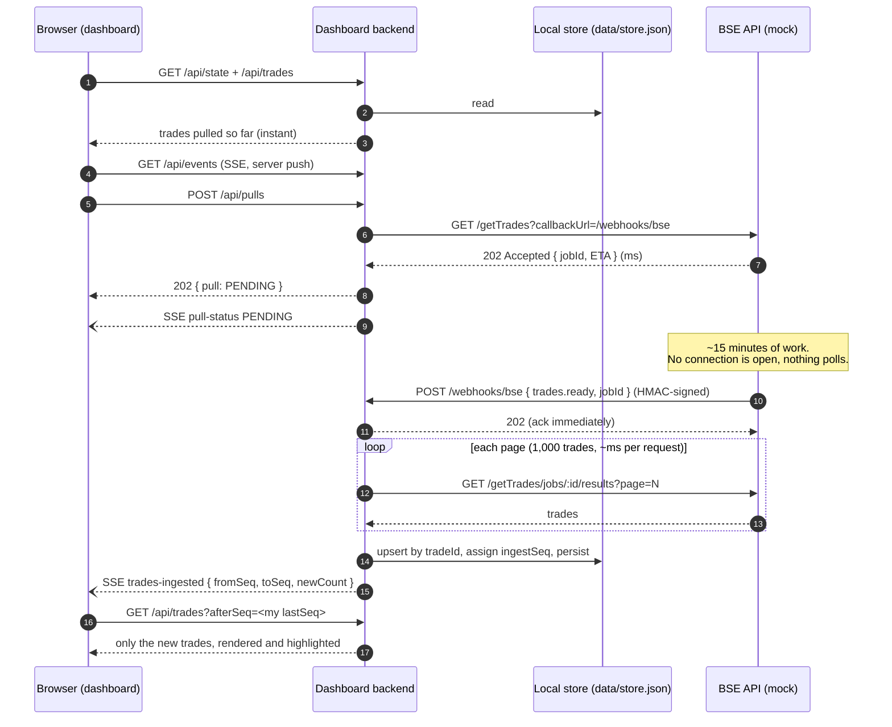
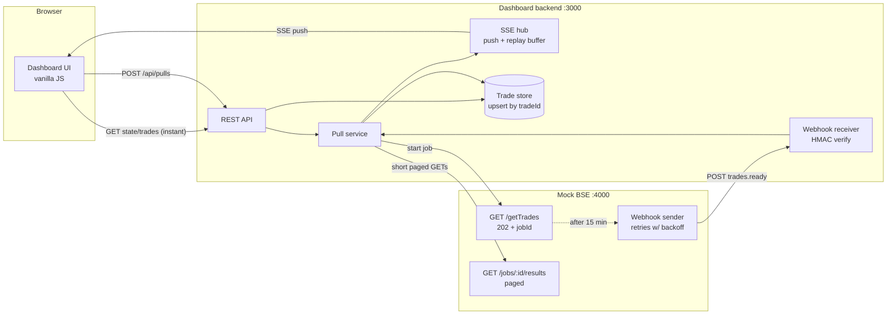

# Architecture note

## The problem in one line

A BSE pull takes **15 minutes**, but the network kills any HTTP connection open for more than **30 seconds**. So nothing in the system can wait for BSE on an open connection: the backend can't, and the browser can't either.

## The design: async job, webhook, local store, server push

## Why this design

| Requirement | How it is met | Why I chose this |
|---|---|---|
| A pull takes 15 min, and connections die after 30 s | `/getTrades` is an **async job**: it returns `202 + jobId` in milliseconds. Results are fetched in **pages**, and each request is short. | This is the standard long-running operation pattern (HTTP 202 + `Location`). Every request finishes in well under a second, so the 30 s limit doesn't matter. |
| Know when the pull is done, without polling or cron | BSE **calls us back** with a signed webhook (`trades.ready`). | It is event-driven, so nothing asks "are you done yet?" on a timer. Webhook delivery is retried with backoff, and on startup the backend checks unfinished jobs **once**, so a missed callback (for example, because the dashboard was down) is never lost. |
| The dashboard opens instantly, even mid-pull | The dashboard **never reads BSE directly**. It reads the **local store**, which holds everything already pulled. | Reads are separated from slow ingestion (a CQRS-style split). Page load costs one local read, however slow BSE is. |
| New trades appear without refresh or polling | **Server-Sent Events.** The backend pushes `trades-ingested`, and the browser fetches only the **delta** (`?afterSeq=N`). | SSE is one-directional server push over plain HTTP. The browser's `EventSource` reconnects on its own, it works through proxies, and it is simpler than WebSockets for this one-way flow. Sending a small event and then fetching the delta keeps events tiny and makes catching up after a gap trivial. |
| SSE must survive the 30 s network limit too | The server **ends each SSE stream after 25 s** and sends `retry: 1000`. The browser reconnects within about 1 s and sends **`Last-Event-ID`**, and the server replays anything missed from a ring buffer. Every (re)connect also starts with `hello { lastSeq }`, so the client can close any gap. | Whether the 30 s limit applies to the browser leg is an assumption, so the design stays correct either way. This is not polling: the client never asks whether something is new, and data only flows when something happens. Set `SSE_MAX_CONN_MS=0` if the browser leg isn't restricted. |
| Correctness | Upsert by **`tradeId`** (idempotent), a monotonic **`ingestSeq`** for deltas, atomic file writes (tmp + rename), one active pull at a time (`409`), and HMAC-verified webhooks. | Webhook retries, a second pull or a crash mid-ingest can never create duplicates or lose trades. |

## Trade-offs and what I would change in production

- **Storage:** a JSON file is enough for a few thousand trades and keeps the project dependency-free. In production I'd use **Postgres**, with a `UNIQUE(trade_id)` and a `BIGSERIAL` ingest sequence.
- **Fan-out across instances:** the SSE hub is in-memory, so it works for one backend instance. To scale out, I'd publish `trades-ingested` through **Redis Pub/Sub or Postgres `LISTEN/NOTIFY`** so every instance pushes to its own clients.
- **Ingestion worker:** I'd move ingestion to a queue such as BullMQ or SQS. The webhook would only enqueue a job, which gives isolation and retries for free.
- **If the real BSE can't send webhooks:** the fallback would be one backend worker that checks job status with exponential backoff. The browser side would stay exactly the same. The dashboard requirement ("no polling loop") is still met, because the browser only ever receives pushes.
- **Security:** the webhook is HMAC-signed and compared in constant time. In production I'd also add a timestamp to block replays, auth on the dashboard, and TLS.
