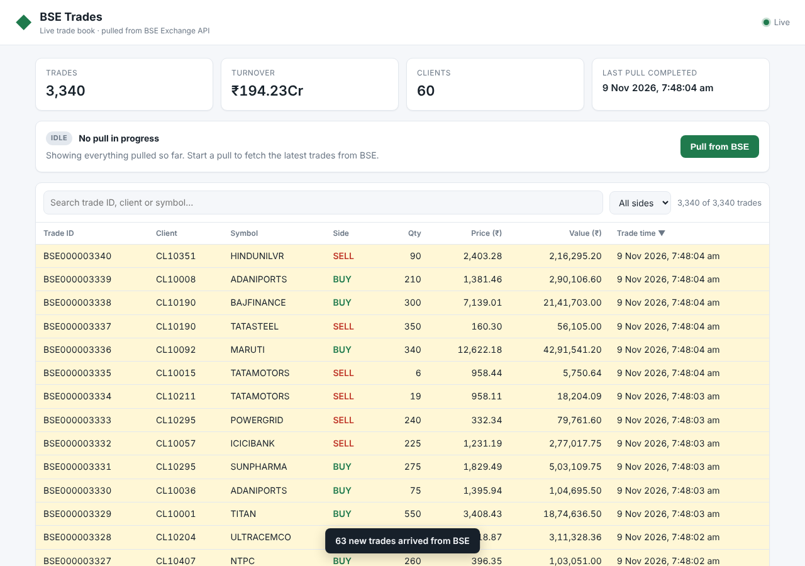

# BSE Trades Dashboard

A mock **BSE Exchange API** whose full pull takes **15 minutes**, plus a **trades dashboard** that:

- opens **instantly** and shows every trade pulled so far, even while a pull is running;
- shows new trades **automatically** when a pull completes, with **no page refresh, no polling loop and no cron job or scheduler**;
- never needs an HTTP connection open for more than **30 seconds**, because the network kills those.



The design is explained in **[ARCHITECTURE.md](ARCHITECTURE.md)**, with diagrams and the reasons for each choice.

---

## Requirements

- **Node.js 18.17+** (tested on Node 22). There are **no npm dependencies**, so you don't need `npm install`.
- Docker is optional.

## Quick start

```bash
git clone <this-repo> && cd bse-trades-dashboard
```

**Option A: quick demo.** A full pull takes 20 seconds instead of 15 minutes:

```bash
npm run demo
```

**Option B: as specified.** A full pull takes 15 minutes:

```bash
npm start
```

Open **http://localhost:3000** and click **Pull from BSE**.

What you should see:

1. The dashboard loads right away. On the first run the table is empty.
2. Click **Pull from BSE**. The pull card shows `PENDING` with a countdown. The page stays usable; open more tabs if you like.
3. When the pull finishes, about 3,000 trades appear in every open tab, highlighted, with a toast. You don't need to refresh.
4. Click **Pull from BSE** again. Only the *new* trades from that run (about 40–150) are added. Nothing is duplicated.
5. Restart the servers or reload the page. Everything already pulled loads instantly, because it is persisted in `data/store.json`.

### Running the services separately

```bash
npm run start:bse
```

```bash
npm run start:dashboard
```

### Docker

```bash
docker compose up --build
```

To use a shorter pull in Docker:

```bash
PULL_DELAY_MS=20000 docker compose up --build
```

### Tests

```bash
npm test
```

The end-to-end test starts both real servers with a 1.5 s pull. It checks:

- `POST /api/pulls` returns at once;
- the dashboard API answers instantly while a pull is running;
- `trades-ingested` is pushed over SSE when the pull completes;
- a second pull only adds the delta, with no duplicates;
- SSE streams are recycled and replay missed events from `Last-Event-ID`;
- webhooks with a bad signature are rejected;
- the mock network really kills connections older than the limit;
- the data survives a restart.

---

## Configuration

Copy `.env.example` to `.env` and adjust it. Environment variables override `.env`.

| Variable | Default | Purpose |
|---|---|---|
| `PULL_DELAY_MS` | `900000` (15 min) | How long a full BSE pull takes |
| `BASE_TRADES` | `3000` | Seeded trades returned by the first pull |
| `NEW_TRADES_MIN` / `NEW_TRADES_MAX` | `40` / `150` | New trades that "happen" on the exchange between pulls |
| `SEED` | `42` | Seed for the generated data |
| `NETWORK_MAX_CONN_MS` | `30000` | The mock network kills TCP connections older than this (`0` turns it off) |
| `WEBHOOK_SECRET` | `change-me-in-prod` | HMAC secret for the BSE → dashboard webhook |
| `BSE_BASE_URL` | `http://127.0.0.1:4000` | Where the dashboard reaches BSE |
| `DASHBOARD_PUBLIC_URL` | `http://localhost:3000` | Where BSE can reach the dashboard's webhook |
| `DATA_FILE` | `./data/store.json` | Where pulled trades are stored |
| `SSE_MAX_CONN_MS` | `25000` | The server recycles each SSE stream before the 30 s limit (`0` = never) |

Per request, you can also call `GET /getTrades?delayMs=5000` to override the delay. Set `ALLOW_DELAY_OVERRIDE=false` to disable this.

---

## API reference

### Mock BSE (`:4000`)

| Method | Path | Description |
|---|---|---|
| `GET` | `/getTrades?callbackUrl=<url>` | Starts a pull. Returns **202** `{ jobId, estimatedReadyAt, statusUrl, resultsUrl }` in milliseconds |
| `POST` | *callbackUrl* | Sent **by BSE** when the job is ready: `{ event: "trades.ready", jobId, totalRecords, totalPages, resultsUrl }`. It is signed with `X-BSE-Signature: sha256=<hmac>` and retried with backoff if delivery fails |
| `GET` | `/getTrades/jobs/:jobId` | Job status |
| `GET` | `/getTrades/jobs/:jobId/results?page=1&pageSize=1000` | One page of trades. Returns `409` while the job is not ready |
| `GET` | `/health` | Health check |

Each trade looks like `{ tradeId, client, symbol, side, quantity, price, timestamp }`.

### Dashboard (`:3000`)

| Method | Path | Description |
|---|---|---|
| `GET` | `/` | Dashboard UI |
| `GET` | `/api/state` | Stats, the active pull and recent pulls |
| `GET` | `/api/trades[?afterSeq=N]` | All trades, or only those ingested after sequence `N` |
| `POST` | `/api/pulls` | Starts a pull. Returns `202`, or `409` if a pull is already running |
| `GET` | `/api/pulls` | Pull history |
| `GET` | `/api/events` | Server-Sent Events: `hello`, `pull-status`, `trades-ingested` |
| `POST` | `/webhooks/bse` | Signed callback from BSE |

---

## Project layout

```
bse-mock/
  server.js           Mock BSE API (async job + webhook + paged results + 30 s network kill)
  tradeGenerator.js   Seeded, deterministic trade generator
dashboard/
  server.js           HTTP server, REST API, static UI, webhook receiver
  pullService.js      Starts pulls, handles the webhook, ingests pages, crash recovery
  store.js            Durable trade store (upsert by tradeId, monotonic ingestSeq)
  events.js           SSE hub (push, heartbeat, 25 s recycle, Last-Event-ID replay)
  public/             index.html, app.js, styles.css (vanilla JS, no build step)
shared/               .env loader, HTTP helpers, HMAC signing
scripts/start-all.js  Runs both services with prefixed logs
test/                 node:test unit + end-to-end tests
```
